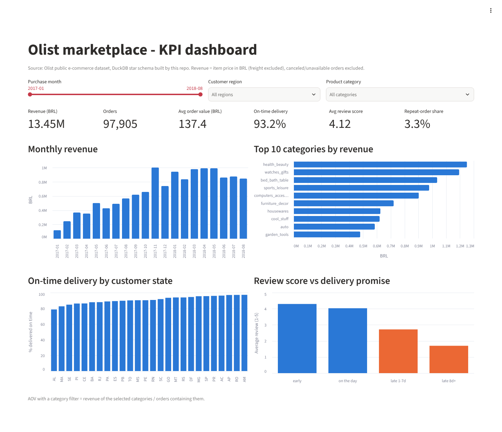
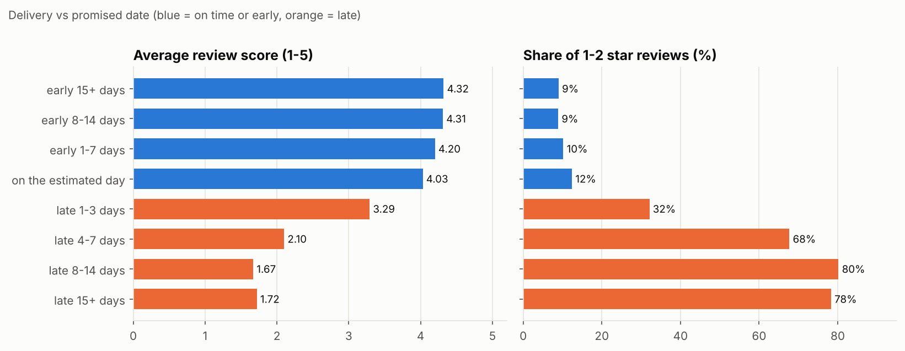
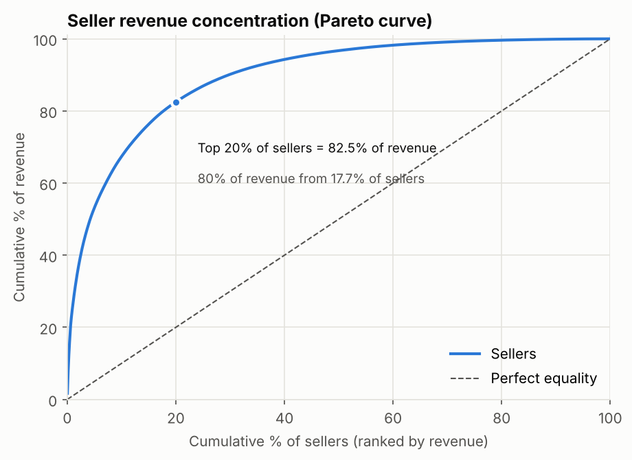

# SQL Business Analytics: Olist e-commerce star schema, KPI report and dashboard

A DuckDB star schema built from raw marketplace data with layered SQL (staging, clean, mart).
SQL data-quality tests run on it, 15 analytical queries answer business questions, and a KPI
report, a Streamlit dashboard and a Power BI build guide sit on top of the same model.



## Business problem

A marketplace management team wants a monthly view of the business. They need to know where
revenue comes from, whether growth is healthy, whether customers come back, and what drives bad
reviews. In practice that is the daily work of a reporting / BI analyst:

1. turn transactional tables into a **clean, documented and tested data model**;
2. answer recurring business questions with **reproducible SQL** (growth, retention, segmentation,
   service levels, concentration);
3. publish the KPIs in a **report and an interactive dashboard**, with definitions that the
   finance and operations teams can reconcile.

## Data

**Brazilian E-Commerce Public Dataset by Olist**: about 99k orders placed on the Olist marketplace
between Sep 2016 and Oct 2018, anonymised and released publicly by Olist. Eight related tables
are used: orders, order items, payments, reviews, customers, sellers, products and category
translation. The geolocation table is not used.

- Source used here: GitHub repository [`olist/work-at-olist-data`](https://github.com/olist/work-at-olist-data)
  (folder `datasets/`, repository under MIT licence). The same data is published by Olist on
  Kaggle under **CC BY-NC-SA 4.0**; this project is non-commercial and attributes Olist as the source.
- `python data/download_data.py` downloads the CSVs (about 64 MB) into `data/raw/`, which is git-ignored.
  Only a tiny hand-made fixture (`tests/fixtures/`) is committed.
- Reporting period: **Jan 2017 to Aug 2018** (complete months). 2016 is a soft-launch period with
  one month missing, and Sep/Oct 2018 hold only 20 orders (truncated extraction).

## Approach

### 1. Layered ETL in SQL (`sql/`)

| Layer | File | What it does |
|---|---|---|
| Staging | `sql/staging/01_staging.sql` | One typed table per CSV with explicit column types (zip codes kept as text, money as `DECIMAL`) |
| Clean | `sql/clean/02_clean.sql` | Trims and normalises text, deduplicates on business keys with `QUALIFY ROW_NUMBER()`, keeps only the latest review per order, translates categories (and fills 2 missing translations), maps states to IBGE macro-regions |
| Mart | `sql/mart/03_mart.sql` | Star schema: `fact_orders` (order grain), `fact_order_items` (line grain), `fact_payments`, and `dim_date`, `dim_customer`, `dim_product`, `dim_seller` |

The ETL is written in SQL and Python only runs the files in order (`src/build_db.py`).
Design choices:

- **Customer = `customer_unique_id`, not `customer_id`.** Olist issues a new `customer_id` for every order.
  Keying the customer dimension on it would make every customer look like a one-time buyer.
- **Two fact tables at different grains.** Revenue, category and seller analysis need the order-line
  grain, while delivery, review and payment KPIs live at order grain. Both connect to shared
  (conformed) date and customer dimensions.
- **Business rules are defined once, in the mart:** `is_valid_sale` (not canceled/unavailable and
  at least one item line), `is_on_time`, `delay_days`, `customer_order_seq`, `is_shipped_late`.
  Every query, the dashboard and the Power BI measures reuse these columns.
- **Revenue = item price, freight excluded** (merchandise revenue in BRL). Freight is reported separately.

### 2. Data-quality tests in SQL (`sql/checks/data_quality.sql`)

There are 31 checks. Each one returns the number of failing rows. They cover row-count and
revenue reconciliation from staging to mart, primary-key uniqueness, not-null keys, referential
integrity from facts to dimensions, value ranges and domains, plus known source issues logged as
warnings. The pipeline stops if an `error`-level check fails. Result on the full data
([full table](reports/data_quality.md)): **24 pass, 7 warnings, 0 errors**.

| Known source issue (warning) | Rows | Treatment |
|---|---:|---|
| Orders without any item line | 775 | not a valid sale (mostly `unavailable`/`canceled`) |
| Orders with more than one review | 547 | latest answered review kept |
| Products without category | 610 | category `unknown`, kept in totals |
| Payments differ from items + freight by > 1 BRL | 312 | payments not used for revenue |
| Handed to carrier before purchase timestamp | 166 | left as is; only affects the seller late-shipping flag |
| Delivered status without delivery timestamp | 8 | counted as not delivered in SLA KPIs |

### 3. Analytical queries (`sql/analysis/`, catalogue in [docs/QUERIES.md](docs/QUERIES.md))

There are 15 commented queries. Each starts with a header giving the business question, the
technique and the insight. `src/queries.py` runs them, saves the full result as CSV
(`reports/query_results/`) and regenerates `docs/QUERIES.md`, so the published tables are
always the real output.

| # | Question | SQL technique |
|---|---|---|
| 01 | Monthly revenue, MoM and YoY growth | `LAG()`, `LAG(.,12)`, moving-average window |
| 02 | YTD KPIs 2018 vs 2017 | conditional aggregation, `LATERAL VALUES` unpivot |
| 03 | Cohort retention matrix | cohort assignment, `date_diff`, non-observable cells as NULL |
| 04 | RFM segmentation | `NTILE(5)` for R and M, rule-based F, `CASE` segments |
| 05 | 12-month customer value by cohort | fixed observation window, median / p90 |
| 06 | Delivery delay vs review score | bucketing, share of all negative reviews |
| 07 | Delivery SLA by state | `HAVING`, `RANK()` |
| 08 | Seller Pareto (80/20) | `NTILE(10)`, running `SUM() OVER` |
| 09 | Category performance and like-for-like growth | `FILTER`, `QUALIFY` top-N |
| 10 | Basket size and composition | order-level `COUNT(DISTINCT)` |
| 11 | Category pairs bought together | self-join, support / confidence / lift |
| 12 | Payment mix and instalments | window shares, mix shift by year |
| 13 | Regional performance | ratios from sums, not averages of ratios |
| 14 | Daily revenue anomaly flags | trailing 28-day mean/sd excluding the current day, z-score |
| 15 | Seller late-shipping scorecard | seller KPIs, volume-weighted averages |

### 4. Reporting layer

- `src/report.py` uses pandas and matplotlib to build six charts and an
  [executive summary](reports/EXECUTIVE_SUMMARY.md). The summary text is filled from the query
  results, with no hand-typed numbers.
- `app.py` is a **Streamlit dashboard** that reads DuckDB directly, with filters for month range,
  region and category. Its parameterised SQL lives in `src/dashboard.py` and is unit-tested.
  `scripts/screenshot_dashboard.py` captures it headless with Playwright (screenshot above).
- `powerbi/POWERBI_GUIDE.md` is a step-by-step guide to rebuild the same model in Power BI Desktop:
  import, relationships, 15 DAX measures, page layout, and a reconciliation table generated from SQL
  ([reports/powerbi_validation.md](reports/powerbi_validation.md)). `python -m src.export_powerbi`
  exports the mart tables as CSV. **No `.pbix` is included**: Power BI Desktop was not available
  in the build environment.

## Results

All figures below come from `python -m src.pipeline` on the full dataset (period Jan 2017 to
Aug 2018, valid sales only).

**Headline KPIs, Jan-Aug 2018 vs Jan-Aug 2017** (query 02)

| KPI | Jan-Aug 2017 | Jan-Aug 2018 | Change |
|---|---:|---:|---:|
| Orders | 22,562 | 53,530 | +137.3% |
| Revenue (BRL) | 3,080,851 | 7,341,037 | +138.3% |
| Average order value (BRL) | 136.55 | 137.14 | +0.4% |
| On-time delivery % | 96.50 | 92.27 | -4.2 pp |
| Avg review score | 4.18 | 4.11 | -1.6% |
| Repeat-order share % | 2.79 | 3.48 | +0.7 pp |

**1. Growth is volume-driven and has stalled since March 2018.** Monthly revenue rose from BRL 120k
(Jan 2017) to BRL 0.85-1.0M, peaking in Nov 2017 (Black Friday). YoY growth slows from +166% in
March to +49% in August 2018.


**2. Late deliveries concentrate the dissatisfaction.** Orders delivered early average 4.2-4.3 stars.
Orders 4-7 days late average 2.10, with 68% of their reviews at 1-2 stars. Late orders are 6.7% of
reviewed deliveries but **32.6% of all negative reviews** (query 06). On-time delivery ranges from
95.9% (PR) to 78.5% (AL), and 8 of the 9 worst states are in the Northeast (query 07).



**3. Customers rarely come back.** In every monthly cohort fewer than 1% of new customers buy again in
any later month (query 03). 12-month revenue per new customer is BRL 131-162, and only 3-5% of it
comes from repeat orders (query 05). In the RFM segmentation, "At risk, high-value" customers
(14.7% of customers, last purchase about 13 months ago) hold 28.8% of revenue (query 04).


**4. Seller revenue follows the 80/20 rule.** The top 10% of sellers make 67.4% of revenue and the top
20% make 82.5% (query 08). Sellers who hand parcels to the carrier late on more than 20% of orders
average a review of 3.78, against 4.15 for sellers late on less than 5% (query 15).



**5. Other findings** (details in [docs/QUERIES.md](docs/QUERIES.md)):
- 90.1% of orders contain a single item. Cross-category pairs are rare and nearly all have lift < 1 (queries 10-11).
- Credit card carries 78.5% of payment value, with 3.5 instalments on average. Boleto falls from 20.0% to 16.9% of value (query 12).
- Northeast customers spend more per order (BRL 165 vs 131 in the Southeast) but wait 20.0 vs 10.7 days (query 13).
- The anomaly detector flags 7 spike days. Black Friday 2017-11-24 is 6.3 times the trailing 28-day mean (query 14).

## Key takeaways, limitations, next steps

**Takeaways.** At this stage, growth comes from acquisition. The quickest levers suggested by the
data are delivery reliability (especially the Northeast and late-shipping sellers) and reactivating
high-value one-time buyers. Both should be measured with controlled experiments before any causal claim.

**Limitations.**
- The data is an anonymised public sample, not the full Olist business. Revenue is merchandise
  value, not company revenue: there is no commission, margin or cost data, so CLV here means
  revenue, not profit.
- The link between delivery delay and review score is an association. Late orders may differ in
  other ways too (region, category, seller).
- On-time rates for the last months are measured only on orders already delivered when the data was
  extracted. Orders still in transit (mostly late ones) are missing, which may flatter August 2018.
- The RFM thresholds and segment names are analyst choices. Frequency is almost always 1, so it is scored by rule, not by quintile.
- The Power BI report itself has not been built or checked here. Only the guide and the reconciliation targets exist.

**Next steps.** Add incremental loading (partition by purchase month), schedule the checks
(e.g. dbt tests or a CI job), add a seller-level SLA alert, and build and reconcile the Power BI
version against `reports/powerbi_validation.md`.

## How to run

```bash
pip install -r requirements.txt
python -m playwright install chromium   # only needed for the dashboard screenshot

make all          # = download data, run the pipeline, run the tests
# or step by step:
python data/download_data.py            # ~64 MB into data/raw/
python -m src.pipeline                  # DuckDB build -> DQ checks -> 15 queries -> charts + summary
python -m pytest                        # 24 tests on a hand-made fixture (no download needed)
streamlit run app.py                    # interactive dashboard on http://localhost:8501
python -m src.export_powerbi            # mart tables as CSV for Power BI (powerbi/data/)
```

Runtime in the build environment (2 CPUs): the pipeline takes about 20 s, the tests about 7 s, and
the dashboard screenshot about 15 s.

## Project structure

```
sql-business-analytics/
├── app.py                     Streamlit dashboard (reads data/olist.duckdb)
├── data/download_data.py      downloads the Olist CSVs into data/raw/ (git-ignored)
├── sql/
│   ├── staging/               01 typed copies of the CSVs
│   ├── clean/                 02 standardisation and deduplication rules
│   ├── mart/                  03 star schema (facts + dimensions, business rules)
│   ├── checks/                data-quality checks (error / warn)
│   ├── analysis/              15 analytical queries with business question + insight
│   └── report/                helper queries for charts and Power BI reconciliation
├── src/
│   ├── build_db.py            runs the ETL SQL in order
│   ├── quality.py             runs checks, fails on errors
│   ├── queries.py             runs analysis SQL, writes CSVs and docs/QUERIES.md
│   ├── report.py              matplotlib charts + executive summary
│   ├── dashboard.py           parameterised SQL for the dashboard
│   ├── export_powerbi.py      mart -> CSV
│   └── pipeline.py            single entry point
├── tests/                     pytest + hand-made CSV fixture (24 tests)
├── reports/                   figures, EXECUTIVE_SUMMARY.md, data_quality.md, query_results/
├── docs/QUERIES.md            generated query catalogue (SQL + real result + insight)
├── powerbi/POWERBI_GUIDE.md   how to rebuild the dashboard in Power BI Desktop
├── Makefile, requirements.txt, LICENSE
```

## Licence

Code: MIT, Copyright (c) 2026 Soukayna Belaaziz. Data: Olist, see the Data section.
