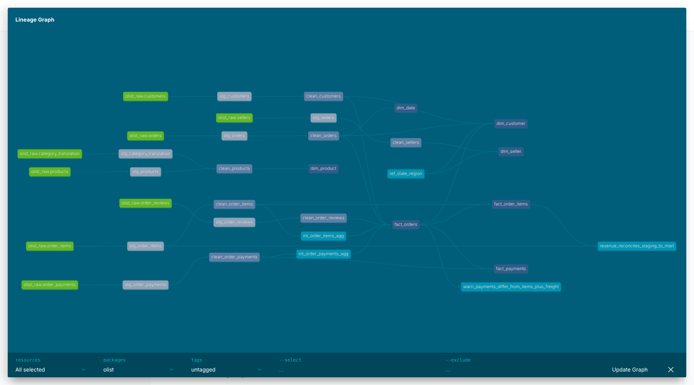
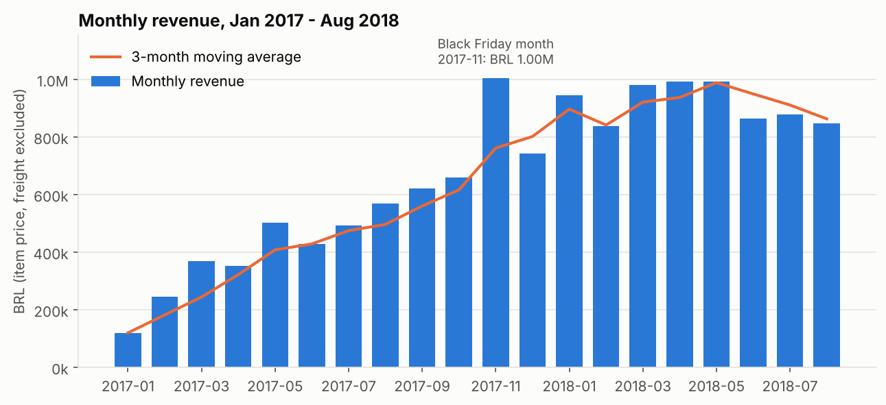
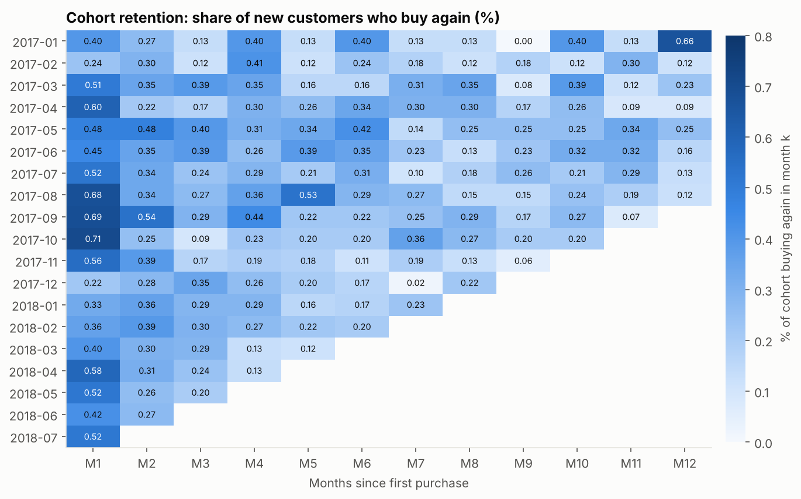
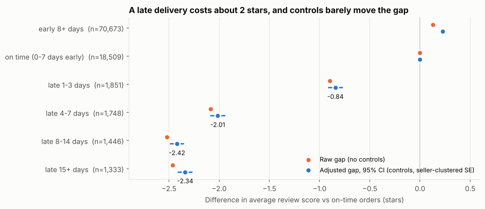
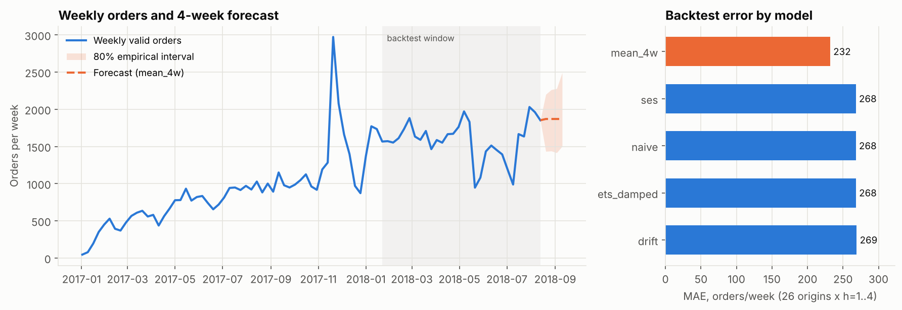

# SQL Business Analytics: Olist e-commerce on dbt + DuckDB, KPI report, impact study and forecast

A dbt project (dbt-core + dbt-duckdb) turns raw marketplace CSVs into a tested star schema.
15 analytical SQL queries, a KPI report, a Streamlit dashboard and a Power BI guide sit on top of it,
plus two analyses that go beyond descriptive reporting (the effect of late delivery on review score,
and a backtested weekly demand forecast) and a one-page memo for a non-technical manager.


**Start here:** [stakeholder memo](reports/STAKEHOLDER_MEMO.md) (one page) |
[impact study and forecast](reports/ANALYSIS_DELAY_AND_FORECAST.md) |
[executive KPI summary](reports/EXECUTIVE_SUMMARY.md) | [query catalogue](docs/QUERIES.md) |
[data-quality tests](reports/data_quality.md)

## Business problem

A marketplace management team wants to know where revenue comes from, whether growth is healthy,
whether customers come back, what drives bad reviews and how many orders to plan for. That is the
work of a reporting / BI analyst: a **tested, documented data model**, **reproducible SQL**, a
**report and dashboard** with reconcilable definitions, and **analysis a manager can act on**.

## Data

**Brazilian E-Commerce Public Dataset by Olist**: about 99k orders placed on the Olist marketplace
between Sep 2016 and Oct 2018, anonymised and released publicly by Olist. Eight related tables
are used: orders, order items, payments, reviews, customers, sellers, products and category
translation. The geolocation table is not used.

- Source used here: GitHub repository [`olist/work-at-olist-data`](https://github.com/olist/work-at-olist-data)
  (folder `datasets/`, repository under MIT licence). The same data is published by Olist on
  Kaggle under **CC BY-NC-SA 4.0**; this project is non-commercial and attributes Olist as the source.
- `python data/download_data.py` downloads the CSVs (about 64 MB) into `data/raw/`, which is git-ignored.
  Only a tiny hand-made fixture (`tests/fixtures/`) is committed.
- Reporting period: **Jan 2017 to Aug 2018** (complete months). 2016 is a soft-launch period with
  one month missing, and Sep/Oct 2018 hold only 20 orders (truncated extraction).

## Approach

### 1. Layered ETL as a dbt project (`olist_dbt/`)

dbt-duckdb installs from PyPI and works here, so the plain-SQL ETL was ported to dbt and removed.
The dbt-built mart is identical, row for row, to the previous SQL build (all 7 tables compared).

| Layer | dbt models | What it does |
|---|---|---|
| Sources | `models/staging/_sources.yml` | The 8 CSVs, read in place by DuckDB (`read_csv`, all text). Path set by the `raw_dir` var |
| Staging | `stg_*` (8) | Explicit cast of every column (zip codes kept as text, money as `DECIMAL(12,2)`) |
| Clean | `clean_*` (7) + seed `ref_state_region` | Trims and normalises text, deduplicates on business keys with `QUALIFY ROW_NUMBER()`, keeps the latest review per order, translates categories (2 missing translations filled), maps states to IBGE macro-regions |
| Intermediate | `int_order_*_agg` (ephemeral) | Order totals from items and payments |
| Mart | `fact_orders`, `fact_order_items`, `fact_payments`, `dim_date`, `dim_customer`, `dim_product`, `dim_seller` | Star schema with the business rules |

`python -m src.pipeline` calls `dbt build` through dbt's Python API (`src/dbt_runner.py`), so models
and tests run in DAG order and a failing error-level test stops everything downstream of it.
`make docs` runs `dbt docs generate` and screenshots the lineage graph with Playwright:



Design choices:

- **Customer = `customer_unique_id`, not `customer_id`.** Olist issues a new `customer_id` for every order.
  Keying the customer dimension on it would make every customer look like a one-time buyer.
- **Two fact tables at different grains.** Revenue, category and seller analysis need the order-line
  grain, while delivery, review and payment KPIs live at order grain. Both connect to shared
  (conformed) date and customer dimensions.
- **Business rules are defined once, in the mart:** `is_valid_sale` (not canceled/unavailable and
  at least one item line), `is_on_time`, `delay_days`, `customer_order_seq`, `is_shipped_late`.
  Every query, the dashboard and the Power BI measures reuse these columns.
- **Revenue = item price, freight excluded** (merchandise revenue in BRL). Freight is reported separately.

### 2. Data-quality tests in dbt

There are 52 dbt tests: built-in generic tests (`unique`, `not_null`, `relationships`,
`accepted_values`), three custom generic tests written for this project (`unique_combination`
for composite keys, `equal_row_count` for staging-to-mart reconciliation, `expression_is_true`
for ranges and rules) and singular tests (revenue reconciled to the cent). Known source issues are
tests with `severity: warn`, so they are reported but do not block the build.
`src/quality.py` turns dbt's `run_results.json` into [reports/data_quality.md](reports/data_quality.md).
Result on the full data: **45 pass, 7 warnings, 0 errors**.

| Known source issue (warning) | Rows | Treatment |
|---|---:|---|
| Orders without any item line | 775 | not a valid sale (mostly `unavailable`/`canceled`) |
| Valid-sale orders without a review | 732 | excluded from review KPIs |
| Products without category | 610 | category `unknown`, kept in totals |
| Orders with more than one review | 547 | latest answered review kept |
| Payments differ from items + freight by > 1 BRL | 312 | payments not used for revenue |
| Handed to carrier before purchase timestamp | 166 | left as is; only affects the seller late-shipping flag |
| Delivered status without delivery timestamp | 8 | counted as not delivered in SLA KPIs |

### 3. Analytical queries (`sql/analysis/`, catalogue in [docs/QUERIES.md](docs/QUERIES.md))

There are 15 commented queries. Each starts with a header giving the business question, the
technique and the insight. `src/queries.py` runs them, saves the full result as CSV
(`reports/query_results/`) and regenerates `docs/QUERIES.md`, so the published tables are
always the real output.

| # | Question | SQL technique |
|---|---|---|
| 01 | Monthly revenue, MoM and YoY growth | `LAG()`, `LAG(.,12)`, moving-average window |
| 02 | YTD KPIs 2018 vs 2017 | conditional aggregation, `LATERAL VALUES` unpivot |
| 03 | Cohort retention matrix | cohort assignment, `date_diff`, non-observable cells as NULL |
| 04 | RFM segmentation | `NTILE(5)` for R and M, rule-based F, `CASE` segments |
| 05 | 12-month customer value by cohort | fixed observation window, median / p90 |
| 06 | Delivery delay vs review score | bucketing, share of all negative reviews |
| 07 | Delivery SLA by state | `HAVING`, `RANK()` |
| 08 | Seller Pareto (80/20) | `NTILE(10)`, running `SUM() OVER` |
| 09 | Category performance and like-for-like growth | `FILTER`, `QUALIFY` top-N |
| 10 | Basket size and composition | order-level `COUNT(DISTINCT)` |
| 11 | Category pairs bought together | self-join, support / confidence / lift |
| 12 | Payment mix and instalments | window shares, mix shift by year |
| 13 | Regional performance | ratios from sums, not averages of ratios |
| 14 | Daily revenue anomaly flags | trailing 28-day mean/sd excluding the current day, z-score |
| 15 | Seller late-shipping scorecard | seller KPIs, volume-weighted averages |

### 4. Beyond descriptive: impact study and forecast (`src/causal.py`, `src/forecast.py`)

- **Effect of a late delivery on the review score.** Late orders are not a random sample (more
  Northeast, more Black Friday, different sellers), so the raw gap is compared with three adjusted
  estimates: OLS with pre-purchase controls (basket, freight, promised lead time, payment, customer
  and seller state, category, month), the same with **seller fixed effects** (late vs on-time
  parcels of the same seller, by within-seller demeaning), and **coarsened exact matching** (ATT).
  Standard errors are clustered by seller. Lead time is not a control: it is how the delay
  happens. The study is observational and says so.
- **Weekly demand forecast.** Naive, 4-week mean, drift, SES and damped-trend ETS, scored by a
  rolling-origin backtest (26 origins x 1-4 weeks ahead, refit at each origin on past data only).
  The 80% interval of the forward forecast comes from the empirical backtest errors.
- Both run on the full data in the pipeline. The estimators are unit-tested on seeded synthetic data
  with a known effect (seller fixed effects must recover it, the raw gap must not).

### 5. Reporting layer

- `src/report.py` uses pandas and matplotlib to build six charts and an
  [executive summary](reports/EXECUTIVE_SUMMARY.md). The summary text is filled from the query
  results, with no hand-typed numbers.
- `app.py` is a **Streamlit dashboard** that reads DuckDB directly, with filters for month range,
  region and category. Its parameterised SQL lives in `src/dashboard.py` and is unit-tested.
  `scripts/screenshot_dashboard.py` captures it headless with Playwright (screenshot above).
- `src/memo.py` writes the [stakeholder memo](reports/STAKEHOLDER_MEMO.md): 3 findings and 3
  recommendations in plain language, every number filled from the results.
- `powerbi/POWERBI_GUIDE.md` is a step-by-step guide to rebuild the same model in Power BI Desktop:
  import, relationships, 15 DAX measures, page layout, and a reconciliation table generated from SQL
  ([reports/powerbi_validation.md](reports/powerbi_validation.md)). `python -m src.export_powerbi`
  exports the mart tables as CSV. **No `.pbix` is included**: Power BI Desktop was not available
  in the build environment.

## Results

All figures below come from `python -m src.pipeline` on the full dataset (period Jan 2017 to
Aug 2018, valid sales only).

**Headline KPIs, Jan-Aug 2018 vs Jan-Aug 2017** (query 02)

| KPI | Jan-Aug 2017 | Jan-Aug 2018 | Change |
|---|---:|---:|---:|
| Orders | 22,562 | 53,530 | +137.3% |
| Revenue (BRL) | 3,080,851 | 7,341,037 | +138.3% |
| Average order value (BRL) | 136.55 | 137.14 | +0.4% |
| On-time delivery % | 96.50 | 92.27 | -4.2 pp |
| Avg review score | 4.18 | 4.11 | -1.6% |
| Repeat-order share % | 2.79 | 3.48 | +0.7 pp |

**1. Growth is volume-driven and has stalled since March 2018.** Monthly revenue rose from BRL 120k
(Jan 2017) to BRL 0.85-1.0M, peaking in Nov 2017 (Black Friday). YoY growth slows from +166% in
March to +49% in August 2018.



**2. Late deliveries concentrate the dissatisfaction.** Orders delivered early average 4.2-4.3 stars.
Orders 4-7 days late average 2.10, with 68% of their reviews at 1-2 stars. Late orders are 6.7% of
reviewed deliveries but **32.6% of all negative reviews** (query 06). On-time delivery ranges from
95.9% (PR) to 78.5% (AL), and 8 of the 9 worst states are in the Northeast (query 07).

**3. Customers rarely come back.** In every monthly cohort fewer than 1% of new customers buy again in
any later month (query 03). 12-month revenue per new customer is BRL 131-162, and only 3-5% of it
comes from repeat orders (query 05). In the RFM segmentation, "At risk, high-value" customers
(14.7% of customers, last purchase about 13 months ago) hold 28.8% of revenue (query 04).



**4. Seller revenue follows the 80/20 rule.** The top 10% of sellers make 67.4% of revenue and the top
20% make 82.5% (query 08). Sellers who hand parcels to the carrier late on more than 20% of orders
average a review of 3.78, against 4.15 for sellers late on less than 5% (query 15).


**5. Other findings** (details in [docs/QUERIES.md](docs/QUERIES.md)):
- 90.1% of orders contain a single item. Cross-category pairs are rare and nearly all have lift < 1 (queries 10-11).
- Credit card carries 78.5% of payment value, with 3.5 instalments on average. Boleto falls from 20.0% to 16.9% of value (query 12).
- Northeast customers spend more per order (BRL 165 vs 131 in the Southeast) but wait 20.0 vs 10.7 days (query 13).
- The anomaly detector flags 7 spike days. Black Friday 2017-11-24 is 6.3 times the trailing 28-day mean (query 14).

**6. A late delivery costs about 2 stars, even comparing like with like** ([full study](reports/ANALYSIS_DELAY_AND_FORECAST.md)).
95,560 delivered and reviewed orders, 6.7% of them late. Effect of being late:

| Method | Review score (stars) | Negative review (1-2 stars), pp |
|---|---:|---:|
| 1. Raw difference | -2.02 [-2.07, -1.97] | +53.2 [51.8, 54.5] |
| 2. OLS + controls | -1.98 [-2.03, -1.93] | +52.6 [51.2, 54.0] |
| 3. OLS + controls + seller fixed effects | -1.94 [-1.99, -1.89] | +51.7 [50.3, 53.1] |
| 4. Coarsened exact matching (ATT, 84.6% of late orders matched) | -1.97 [-2.03, -1.91] | +52.2 [50.6, 53.7] |

95% CIs, seller-clustered. The adjustments move the gap by less than 0.1 star, so the observed
differences between late and on-time orders explain little of it. The effect grows with the delay
(-0.84 stars at 1-3 days late, -2.42 at 8-14 days). 83.6% of late orders were reviewed *before*
the parcel arrived (3.1% of the others), because the survey goes out at the promised date.



**7. Weekly demand is on a plateau; a 4-week mean beats the naive forecast by 13%.** Rolling-origin
backtest, 26 origins x 1-4 weeks ahead, MAE in orders per week:

| Model | MAE | MAPE % | MAE vs naive | MAE h=1 | MAE h=4 |
|---|---:|---:|---:|---:|---:|
| 4-week mean | 232 | 16.5 | 0.87 | 193 | 263 |
| Naive (last week); SES and damped ETS are identical to 1 decimal of MAPE | 268 | 19.2 | 1.00 | 170 | 324 |
| Drift | 269 | 19.7 | 1.00 | 172 | 329 |

The ETS models estimate a level smoothing weight of 1.00 (the 2017 ramp-up looks like permanent
level shifts), so they reduce to the naive forecast. Naive is still best one week ahead.
Forecast for the 4 weeks after 13 Aug 2018: 1,869 orders/week, 80% empirical interval 1,415 to
2,491 (not checkable: the extract ends).



## Key takeaways, limitations, next steps

**Takeaways.** At this stage, growth comes from acquisition. The quickest lever suggested by the
data is delivery reliability (especially the Northeast and late-shipping sellers): the review
penalty of a late order is stable across four specifications. Reactivating high-value one-time
buyers is the second lever. Both should be confirmed with controlled experiments
(see the [memo](reports/STAKEHOLDER_MEMO.md)).

**Limitations.**
- The data is an anonymised public sample, not the full Olist business. Revenue is merchandise
  value, not company revenue: there is no commission, margin or cost data, so CLV here means
  revenue, not profit.
- The delay study is observational. It adjusts for observed differences (region, season, basket,
  category, seller), not for unobserved ones (fragile goods, a bad carrier route). Only reviewed
  orders enter it, and unreviewed delivered orders are late more often (23.8% vs 6.7%).
- The public extract fades out after 22 Aug 2018 (daily orders drop from about 250 to under 100),
  so August 2018 and the Jan-Aug 2018 totals are slightly understated. The forecast series stops at
  the week of 13 Aug 2018 for that reason.
- The forecast has one partial year of history: no yearly seasonality, no promotion calendar.
- On-time rates for the last months are measured only on orders already delivered when the data was
  extracted. Orders still in transit (mostly late ones) are missing, which may flatter August 2018.
- The RFM thresholds and segment names are analyst choices. Frequency is almost always 1, so it is scored by rule, not by quintile.
- The Power BI report itself has not been built or checked here. Only the guide and the reconciliation targets exist.

**Next steps.** Incremental dbt models (partition by purchase month), source freshness checks,
a seller-level SLA alert, a randomised test of the delivery promise, and building and reconciling the
Power BI version against `reports/powerbi_validation.md`.

## Continuous integration

`.github/workflows/ci.yml` installs `requirements.txt` on Python 3.13, runs `dbt parse` and then
`pytest`, which builds the whole dbt project on the committed fixture and runs all dbt and Python
tests. No data download is needed. The workflow has not run on GitHub yet (the repository is not
pushed); the same steps were run locally in a fresh virtual environment and pass.

## How to run

```bash
pip install -r requirements.txt
python -m playwright install chromium   # only needed for the dashboard screenshot

make all          # = download data, run the pipeline, run the tests
# or step by step:
python data/download_data.py            # ~64 MB into data/raw/
python -m src.pipeline                  # dbt build (ETL + 52 tests) -> 15 queries -> charts, summary
                                        # -> delay study + forecast -> stakeholder memo
python -m pytest                        # 29 tests on a hand-made fixture (no download needed)
make docs                               # dbt docs site + lineage screenshot
streamlit run app.py                    # interactive dashboard on http://localhost:8501
python -m src.export_powerbi            # mart tables as CSV for Power BI (powerbi/data/)
```

Runtime in the build environment (2 CPUs, shared with other jobs): the pipeline takes 99-110 s
(dbt build about 40 s, delay study and forecast about 40 s), `make docs` 15 s, the tests 20-60 s.

## Project structure

```
sql-business-analytics/
├── olist_dbt/                 dbt project: models/{staging,clean,intermediate,marts}, seeds/, tests/
├── sql/analysis/              15 analytical queries with business question + insight
├── sql/analytics/, sql/report/  datasets for the delay study / forecast, chart + Power BI helpers
├── src/
│   ├── dbt_runner.py, build_db.py, quality.py   dbt build, DuckDB file, dbt test results
│   ├── queries.py, report.py                    queries -> CSVs, QUERIES.md, charts, summary
│   ├── causal.py, forecast.py, insights.py      delay study, forecast + backtest, their report
│   ├── memo.py                                  stakeholder memo
│   ├── dashboard.py, export_powerbi.py          dashboard SQL, mart -> CSV
│   └── pipeline.py                              single entry point
├── app.py                     Streamlit dashboard (reads data/olist.duckdb)
├── scripts/                   Playwright screenshots (dashboard, dbt lineage)
├── tests/                     pytest + hand-made CSV fixture (29 tests)
├── reports/                   memo, analyses, summary, data_quality.md, figures/, result CSVs
├── docs/QUERIES.md            generated query catalogue (SQL + real result + insight)
├── powerbi/POWERBI_GUIDE.md   how to rebuild the dashboard in Power BI Desktop
├── data/download_data.py      downloads the Olist CSVs into data/raw/ (git-ignored)
├── .github/workflows/ci.yml   CI: dbt parse + pytest on the fixture
└── Makefile, requirements.txt, LICENSE
```

## Licence

Code: MIT, Copyright (c) 2026 Soukayna Belaaziz. Data: Olist, see the Data section.
