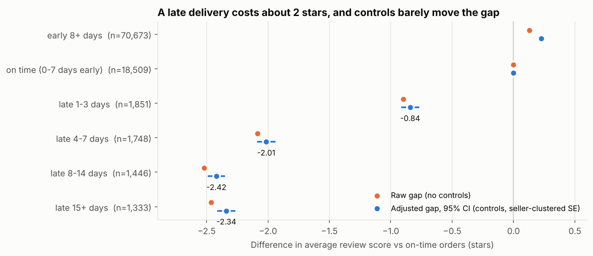
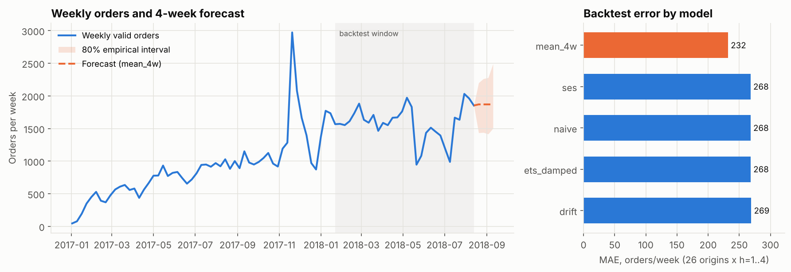

# Delivery delay vs review score, and a weekly demand forecast

Generated by `python -m src.pipeline` (`src/causal.py`, `src/forecast.py`, `src/insights.py`).
Result tables: `reports/analysis_results/`.

## 1. How much does a late delivery cost in review score? (observational study)

**Population.** 95,560 valid-sale orders purchased Jan 2017 to Aug 2018, delivered
and reviewed. 6,378 (6.7%) arrived after the promised date.
Negative-review rate (1-2 stars): 9.2% when not late, 62.4% when late.

**Why the raw gap could mislead.** Late orders differ from the others before anything goes wrong:

| covariate | not late | late |
|---|---:|---:|
| Promised lead time (days) | 24.35 | 23.26 |
| Basket value (BRL) | 135.86 | 149.43 |
| Freight (BRL) | 22.64 | 25.21 |
| Seller in customer's state | 0.37 | 0.24 |
| Multi-seller order | 0.01 | 0 |
| Customer in Northeast | 0.09 | 0.18 |
| Bought in Nov 2017 | 0.07 | 0.14 |

**Estimates of the late-delivery effect** (standard errors clustered by seller):

| outcome | method | effect | unit | 95% CI | n_obs |
|---|---|---|---|---|---:|
| Review score (1-5) | 1. Raw difference | -2.02 | stars | [-2.07, -1.97] | 95,560 |
| Review score (1-5) | 2. OLS + controls | -1.98 | stars | [-2.03, -1.93] | 95,560 |
| Review score (1-5) | 3. OLS + controls + seller FE | -1.94 | stars | [-1.99, -1.89] | 95,036 |
| Review score (1-5) | 4. Coarsened exact matching (ATT) | -1.97 | stars | [-2.03, -1.91] | 39,285 |
| Negative review (1-2 stars) | 1. Raw difference | +53.17 | pp | [51.81, 54.53] | 95,560 |
| Negative review (1-2 stars) | 2. OLS + controls | +52.58 | pp | [51.21, 53.95] | 95,560 |
| Negative review (1-2 stars) | 3. OLS + controls + seller FE | +51.73 | pp | [50.33, 53.12] | 95,036 |
| Negative review (1-2 stars) | 4. Coarsened exact matching (ATT) | +52.16 | pp | [50.62, 53.69] | 39,285 |

Controls (all known at purchase time): log basket value, log freight, number of items, multi-seller
order, promised lead time, instalments, payment type, customer state, seller state, main product
category, purchase month. Seller fixed effects compare late and on-time parcels *of the same seller*.
Coarsened exact matching compares each late order with on-time orders of the same customer state,
quarter, category, promised-lead-time band and basket-value quartile; 84.6% of
late orders found a match.

**Reading.** The four review-score estimates range from -1.94 to
-2.02 stars. Adding controls, seller fixed effects or matching moves the raw
gap by less than 0.1 star, so the observed differences between late and on-time orders (region,
season, basket, seller) explain very little of it. The gap grows with the delay and saturates
after about one week:

| delay_bucket | orders | mean_outcome | raw_gap | adjusted_gap | adjusted_se |
|---|---:|---:|---:|---:|---:|
| early 8+ days | 70,673 | 4.32 | 0.13 | 0.23 | 0.01 |
| on time (0-7 days early) | 18,509 | 4.19 | 0 | 0 | 0 |
| late 1-3 days | 1,851 | 3.29 | -0.9 | -0.84 | 0.04 |
| late 4-7 days | 1,748 | 2.1 | -2.09 | -2.01 | 0.04 |
| late 8-14 days | 1,446 | 1.67 | -2.52 | -2.42 | 0.04 |
| late 15+ days | 1,333 | 1.73 | -2.46 | -2.34 | 0.04 |

**Mechanism worth knowing.** According to the dataset description, the satisfaction survey is
e-mailed when the product arrives or when the estimated delivery date is reached, whichever comes
first. 83.6% of late orders were reviewed *before the parcel arrived* (vs
3.1% of the others): the bad review is written while the customer is still waiting.

**Caveats (why this is "causal-flavoured", not causal).**
- Observational data: the estimates are causal only if nothing unobserved drives both lateness
  and the score (fragile or bulky goods, a bad carrier route, a stock-out the seller hid).
  Stability across specifications is reassuring but is not proof.
- Lateness is measured against Olist's own promise. A longer promise reduces "late" by definition;
  the effect is of missing the promise, not of slow delivery in itself.
- Only reviewed orders are analysed. The 643 delivered orders without a
  review were late 23.8% of the time (vs 6.7% in the
  sample), so the sample under-represents late deliveries.
- A linear model on a 1-5 score; the negative-review model is a linear probability model. Both are
  read as average differences, which is what a manager needs.
- The clean test would be an experiment, e.g. randomly padding the promised date for a subset of
  routes and comparing review scores.

## 2. Weekly demand forecast

**Series.** 85 complete weeks of valid orders, 2017-01-02 to
2018-08-13. The series stops there because the public extract fades out
after 22 Aug 2018 (daily orders drop from about 250 to under 100), which is an extraction artefact,
not demand.

**Backtest.** Rolling origin: at each of the last 26 weeks every model is refit on the past
only and forecasts 1 to 4 weeks ahead (104 forecasts per model).

| model | mae | mape_pct | bias | mae_vs_naive | mae_h1 | mae_h2 | mae_h3 | mae_h4 |
|---|---:|---:|---:|---:|---:|---:|---:|---:|
| mean_4w | 231.99 | 16.5 | -7.26 | 0.86 | 192.61 | 233.3 | 239.47 | 262.57 |
| ses | 268.13 | 19.18 | -26.04 | 1 | 169.61 | 267.65 | 311.23 | 324.03 |
| naive | 268.13 | 19.18 | -26.04 | 1 | 169.62 | 267.65 | 311.23 | 324.04 |
| ets_damped | 268.25 | 19.18 | -26.23 | 1 | 169.44 | 267.86 | 311.43 | 324.25 |
| drift | 269.25 | 19.69 | 30.38 | 1 | 171.57 | 263.02 | 313.47 | 328.95 |

**Reading.** `mean_4w` has the lowest error: MAE 232 orders/week
(MAPE 16.5%), 13% below the
naive forecast. The naive forecast is still best one week ahead (MAE
170 vs 193); averaging wins from two
weeks ahead. Fitted by maximum likelihood on this history, the ETS models put almost all weight
on the last week (SES level smoothing = 1.00; 1 = naive), because the 2017
ramp-up looks like a series of permanent level shifts, so they behave like the naive forecast. With one partial year of
history, yearly seasonality (Black Friday, Christmas) cannot be estimated, and in 2018 weekly demand
moves around a plateau of about 1,611 orders.

**Forward forecast** (`mean_4w`, 80% interval from the empirical distribution of its
backtest errors at each horizon):

| week_start | model | forecast | pi_low | pi_high |
|---|---|---:|---:|---:|
| 2018-08-20 | mean_4w | 1,869 | 1,433 | 2,199 |
| 2018-08-27 | mean_4w | 1,869 | 1,438 | 2,262 |
| 2018-09-03 | mean_4w | 1,869 | 1,415 | 2,278 |
| 2018-09-10 | mean_4w | 1,869 | 1,501 | 2,491 |

These weeks fall after the end of the extract, so they cannot be checked against actuals.

**Limitations and next steps.** No promotion calendar, prices or marketing spend are available,
which is where a forecast usually gains most. With 2+ years of data: yearly seasonality
(seasonal ETS or holiday regressors for Black Friday and Christmas), fitting on the post-ramp-up
period only, and forecasts by region/category reconciled to the total.
