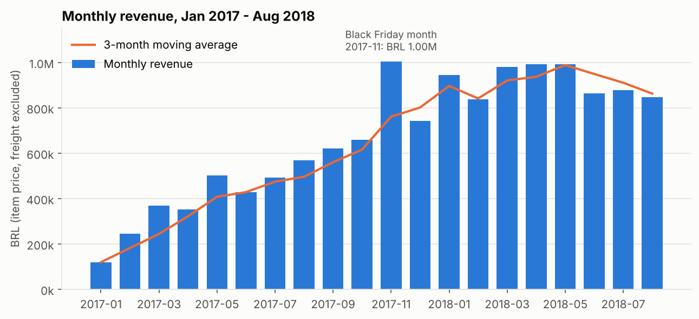
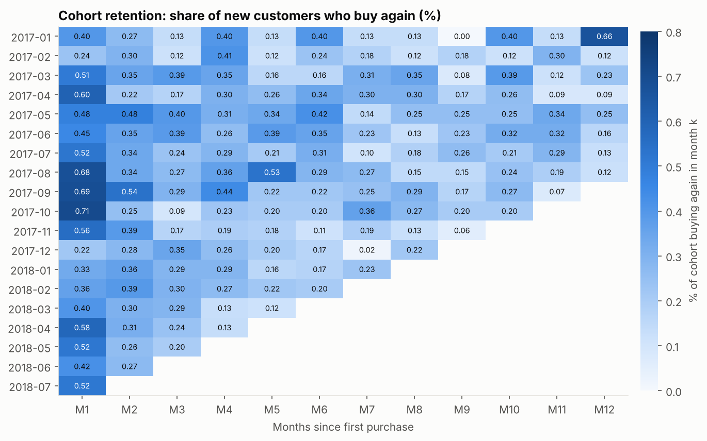
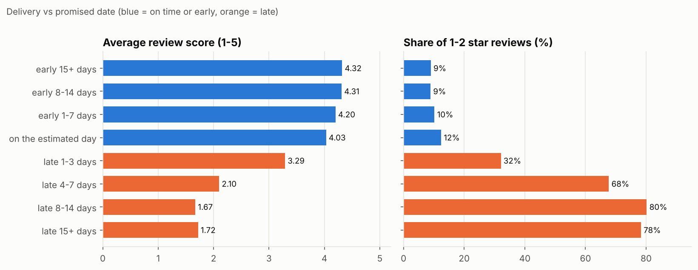
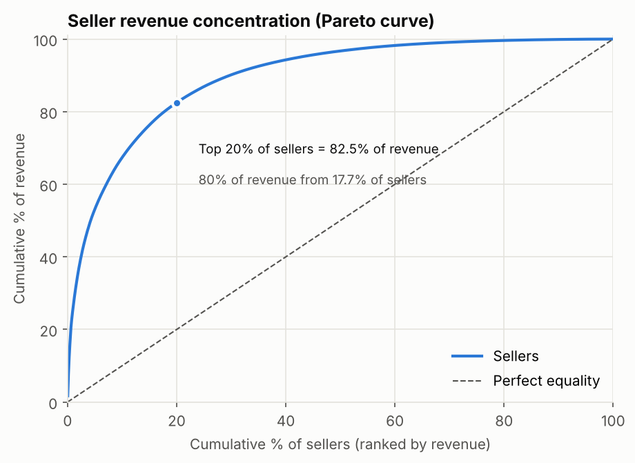
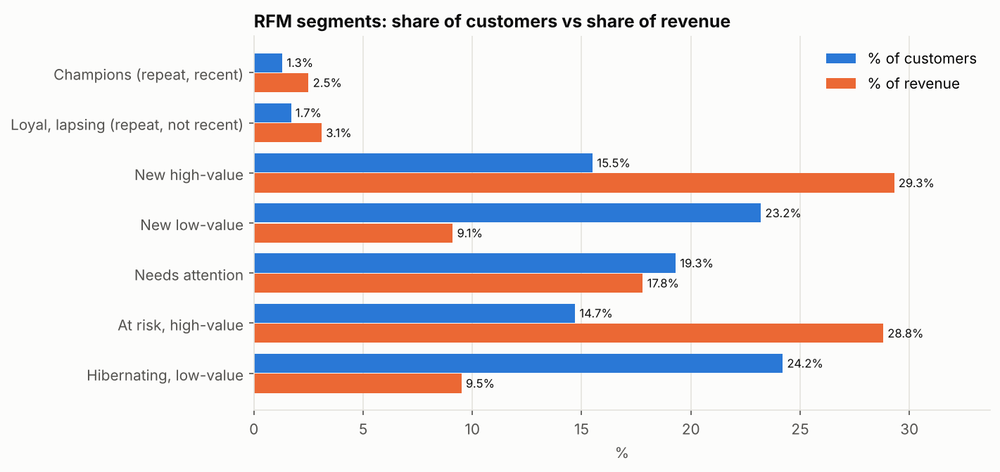
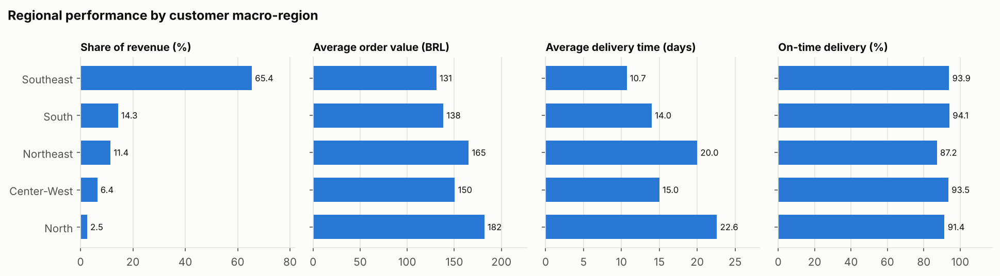

# Executive summary - Olist marketplace KPI report

*Generated by `python -m src.pipeline` from the DuckDB mart. Period: Jan 2017 - Aug 2018
(complete months). Revenue = item price in BRL, freight excluded; canceled/unavailable
orders excluded.*

## Headline KPIs, year to date

| KPI | Jan-Aug 2017 | Jan-Aug 2018 | Change % |
|---|---:|---:|---:|
| Orders | 22,562 | 53,530 | 137.3 |
| Active customers | 21,936 | 52,336 | 138.6 |
| Revenue (BRL) | 3,080,850.8 | 7,341,037.4 | 138.3 |
| Freight billed (BRL) | 494,224.0 | 1,254,633.9 | 153.9 |
| Average order value (BRL) | 136.55 | 137.14 | 0.4 |
| Items per order | 1.13 | 1.14 | 0.7 |
| On-time delivery % | 96.5 | 92.27 | -4.4 |
| Avg delivery days | 12.18 | 12.14 | -0.4 |
| Avg review score | 4.18 | 4.11 | -1.6 |
| Repeat-order share % | 2.79 | 3.48 | 24.8 |

## Five things management should know

1. **Growth is volume-driven and has plateaued.** Jan-Aug revenue is
   +138.3% year on year, with orders
   +137.3% and AOV almost flat
   (+0.4%). Monthly revenue has moved
   sideways since March 2018; YoY growth in 2018-08 is +49.4%.
2. **Late deliveries concentrate the bad reviews.** Late orders are 6.7% of
   reviewed deliveries but 32.6% of all 1-2 star reviews. On-time delivery fell from
   96.5% to 92.3%.
3. **Customers almost never come back.** In no cohort do more than 0.71% of new
   customers buy again in the following month; repeat orders are
   3.5% of 2018 orders. The
   "At risk, high-value" RFM segment holds 28.8% of revenue
   (13,967 customers, last purchase about 395 days ago).
4. **Seller base is highly concentrated.** The top 20% of sellers generate 82.5% of revenue.
5. **The Northeast is under-served.** It is 11.4% of revenue with the highest
   AOV among large regions (BRL 165 vs 131 in the Southeast), but
   deliveries take 20.0 days vs 10.7 and only
   87.2% arrive on time.

## Suggested actions (to be validated with the business)

- Logistics: set a late-delivery alert per seller and customer state and review delivery-date promises in the
  Northeast; track On-time Delivery % weekly next to revenue.
- CRM: win-back campaign for the "At risk, high-value" segment; measure with a hold-out group.
- Seller management: key-account coverage for the top two revenue deciles; shipping-SLA
  enforcement for sellers who hand parcels to the carrier late (query 15).

## Charts

### Monthly revenue and 3-month moving average

### Cohort retention matrix (months 1-12)

### Delivery delay vs review score

### Seller Pareto curve

### RFM segments

### Regional performance

Full query results: `reports/query_results/`. Query catalogue with SQL and insights: `docs/QUERIES.md`.
